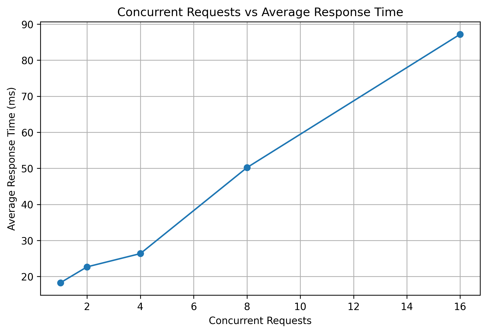
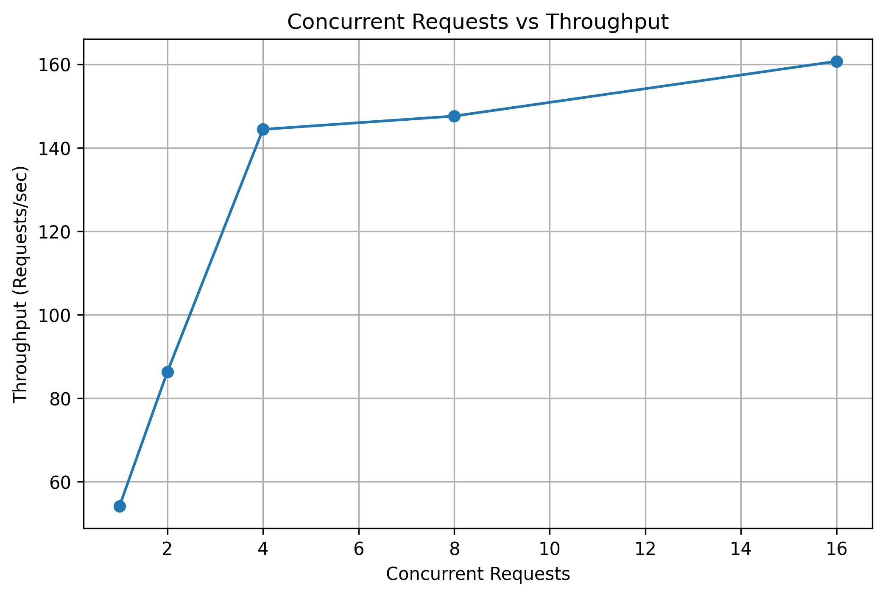
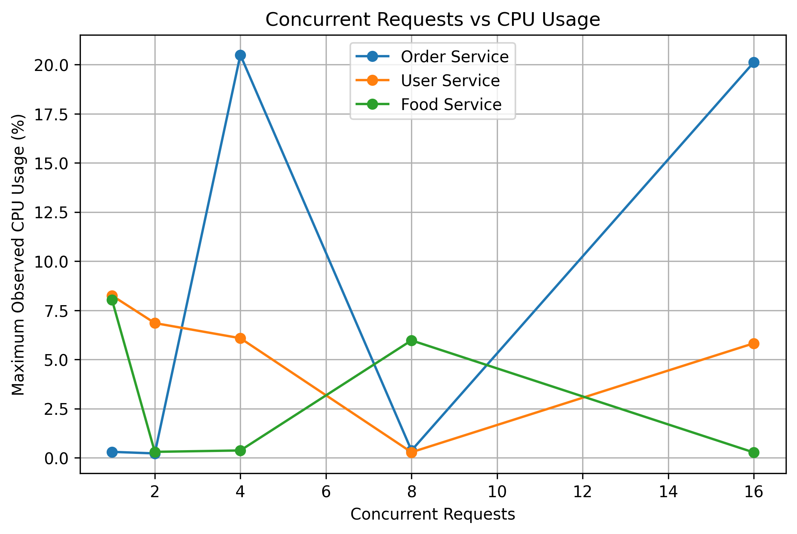
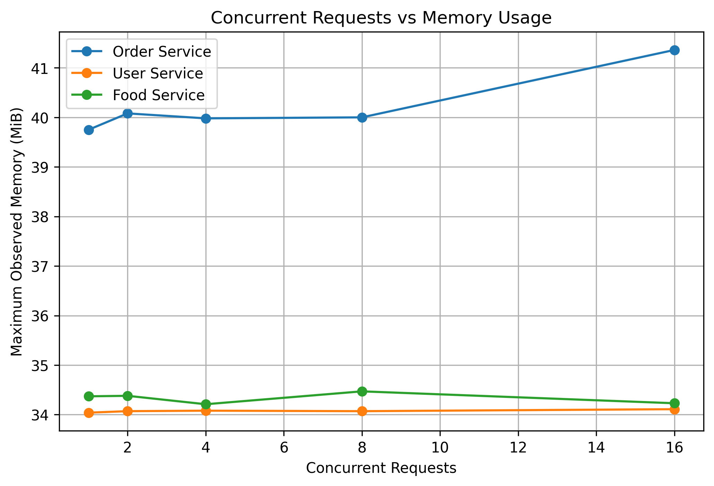

# Food Online Microservices – Containerized Workload Analysis

## 1. Project Overview

This project implements a containerized microservice-based application for an online food ordering system.

The application consists of three independent REST-based microservices:

1. **User Service** – manages customer information.
2. **Food Service** – manages food and menu information.
3. **Order Service** – creates orders and communicates with the User and Food services.

Each microservice is developed using **Python and FastAPI** and deployed as a separate Docker container.

Docker Compose is used to build, deploy, and connect all three services through a common Docker bridge network.

The application is tested under different concurrent workloads to analyze:

* Response time
* Throughput
* CPU utilization
* Memory consumption
* Request failures

---

## 2. Objectives

The objectives of this experiment are:

* Develop three independent microservices.
* Expose REST APIs for each service.
* Containerize each microservice using Docker.
* Deploy the services using Docker Compose.
* Configure inter-service communication using Docker service names.
* Test an end-to-end order request.
* Evaluate performance under different concurrency levels.
* Measure response time and throughput.
* Monitor CPU and memory utilization.
* Generate performance graphs.
* Analyze performance degradation under increasing workloads.

---

## 3. System Architecture

```text
                         Client
                           |
                           v
                  +------------------+
                  |  Order Service   |
                  |    Port 8000     |
                  +------------------+
                     /            \
                    /              \
                   v                v
          +----------------+  +----------------+
          |  User Service  |  |  Food Service  |
          |    Port 8001   |  |    Port 8002   |
          +----------------+  +----------------+

             Docker Bridge Network
      food-online-microservices_food-network
```

### Request Flow

```text
Client
  |
  v
Order Service
  |
  +------> User Service
  |
  +------> Food Service
  |
  v
Combined Order Response
```

The Order Service acts as the central service for creating an order. It retrieves customer information from the User Service and food information from the Food Service before returning the combined order response.

---

## 4. Microservices

### 4.1 User Service

**Responsibility:** Manage customer information.

**Port:** `8001`

| Method | Endpoint           | Description               |
| ------ | ------------------ | ------------------------- |
| GET    | `/`                | Check service status      |
| GET    | `/users/{user_id}` | Retrieve user information |

Example:

```text
GET http://localhost:8001/users/1
```

Example response:

```json
{
  "id": 1,
  "name": "Sukanya",
  "email": "sukanya@example.com"
}
```

---

### 4.2 Food Service

**Responsibility:** Manage food and menu information.

**Port:** `8002`

| Method | Endpoint           | Description             |
| ------ | ------------------ | ----------------------- |
| GET    | `/`                | Check service status    |
| GET    | `/foods/{food_id}` | Retrieve a food item    |
| GET    | `/foods`           | Retrieve all food items |

Example:

```text
GET http://localhost:8002/foods/1
```

Example response:

```json
{
  "id": 1,
  "name": "Veg Burger",
  "price": 120,
  "category": "Burger"
}
```

---

### 4.3 Order Service

**Responsibility:** Create orders by communicating with the User Service and Food Service.

**Port:** `8000`

| Method | Endpoint  | Description          |
| ------ | --------- | -------------------- |
| GET    | `/`       | Check service status |
| POST   | `/orders` | Create an order      |

Example:

```text
POST http://localhost:8000/orders?user_id=1&food_id=1
```

Example response:

```json
{
  "message": "Order created successfully",
  "customer": {
    "id": 1,
    "name": "Sukanya",
    "email": "sukanya@example.com"
  },
  "food": {
    "id": 1,
    "name": "Veg Burger",
    "price": 120,
    "category": "Burger"
  },
  "total_amount": 120
}
```

---

## 5. Technologies Used

| Technology            | Purpose                          |
| --------------------- | -------------------------------- |
| Python 3.13           | Application development          |
| FastAPI               | REST API development             |
| Uvicorn               | Application server               |
| Requests              | Inter-service HTTP communication |
| Docker                | Containerization                 |
| Docker Compose        | Multi-container deployment       |
| Docker Bridge Network | Inter-service communication      |
| ThreadPoolExecutor    | Concurrent workload generation   |
| Pandas                | Result processing                |
| Matplotlib            | Performance graphs               |
| REST API              | Service communication            |
| JSON                  | Data exchange format             |

---

## 6. Project Structure

```text
Food-Online-Microservices/
│
├── docker-compose.yml
├── .gitignore
├── README.md
│
├── docs/
│   └── analysis.md
│
├── results/
│   ├── figures/
│   │   ├── concurrency_vs_cpu.png
│   │   ├── concurrency_vs_memory.png
│   │   ├── concurrency_vs_response_time.png
│   │   └── concurrency_vs_throughput.png
│   │
│   └── raw/
│       ├── workload_results.csv
│       └── workload_resource_results.csv
│
├── screenshots/
│   ├── 01-user-service.png
│   ├── 02-food-service.png
│   ├── 03-order-service.png
│   ├── 04-docker-compose-ps.png
│   ├── 05-docker-images.png
│   └── 06-docker-network.png
│
├── services/
│   ├── user-service/
│   │   ├── app.py
│   │   ├── Dockerfile
│   │   └── requirements.txt
│   │
│   ├── food-service/
│   │   ├── app.py
│   │   ├── Dockerfile
│   │   └── requirements.txt
│   │
│   └── order-service/
│       ├── app.py
│       ├── Dockerfile
│       └── requirements.txt
│
└── workload/
    ├── load_test.py
    └── generate_graphs.py
```

---

# 7. Docker Configuration

Each microservice has its own Dockerfile.

The Dockerfiles:

* Use Python 3.13 slim.
* Install the required dependencies.
* Copy the application code.
* Expose the required port.
* Start the FastAPI application using Uvicorn.

The three services are built and deployed using `docker-compose.yml`.

---

# 8. Commands Used During the Experiment

## 8.1 Build Docker Images

Build all three services:

```powershell
docker compose build
```

Build only the Order Service:

```powershell
docker compose build order-service
```

---

## 8.2 Start the Containers

Start all services:

```powershell
docker compose up -d
```

Recreate the Order Service after rebuilding:

```powershell
docker compose up -d --force-recreate order-service
```

---

## 8.3 Check Running Containers

```powershell
docker compose ps
```

```powershell
docker ps
```

---

## 8.4 Check Docker Images

```powershell
docker images
```

---

## 8.5 Check Docker Network

List Docker networks:

```powershell
docker network ls
```

Inspect the application network:

```powershell
docker network inspect food-online-microservices_food-network
```

---

## 8.6 Test Container-to-Container Communication

Test communication between Order Service and User Service:

```powershell
docker exec order-service python -c "import requests; r=requests.get('http://user-service:8001/users/1'); print(r.status_code); print(r.text)"
```

Test communication between Order Service and Food Service:

```powershell
docker exec order-service python -c "import requests; r=requests.get('http://food-service:8002/foods/1'); print(r.status_code); print(r.text)"
```

A successful communication test returns HTTP status code `200`.

---

## 8.7 Test REST APIs

### User Service

```text
http://localhost:8001/users/1
```

### Food Service

```text
http://localhost:8002/foods/1
```

### Order Service Swagger UI

```text
http://localhost:8000/docs
```

The Order Service was tested using:

```text
POST /orders?user_id=1&food_id=1
```

---

## 8.8 Monitor Docker Resources

View live resource usage:

```powershell
docker stats
```

Take a single snapshot:

```powershell
docker stats --no-stream
```

CPU and memory statistics were also collected automatically during workload testing.

---

## 8.9 Run Workload Testing

The workload test was executed using:

```powershell
py -3.13 workload\load_test.py
```

The following concurrency levels were tested:

```text
1, 2, 4, 8, 16
```

Each concurrency level generated 50 requests.

---

## 8.10 Generate Performance Graphs

The graphs were generated using:

```powershell
py -3.13 workload\generate_graphs.py
```

The graphs are saved in:

```text
results/figures/
```

Generated graphs:

* Concurrency vs Response Time
* Concurrency vs Throughput
* Concurrency vs CPU
* Concurrency vs Memory

---

## 8.11 View Container Logs

Order Service:

```powershell
docker logs order-service
```

User Service:

```powershell
docker logs user-service
```

Food Service:

```powershell
docker logs food-service
```

---

## 8.12 Stop the Application

```powershell
docker compose down
```

---

# 9. Docker Network and Inter-Service Communication

All three services are connected to the same Docker bridge network:

```text
food-online-microservices_food-network
```

The Order Service communicates with:

```text
http://user-service:8001
http://food-service:8002
```

Docker service names are used instead of `localhost` for communication between containers.

This allows the services to communicate directly through the Docker network.

---

# 10. End-to-End Communication

For the following request:

```text
user_id = 1
food_id = 1
```

The Order Service performs the following steps:

1. Receives the order request.
2. Contacts the User Service.
3. Retrieves customer information.
4. Contacts the Food Service.
5. Retrieves food information.
6. Combines the information.
7. Returns the completed order response.

This demonstrates successful inter-service communication between the three containers.

---

# 11. Workload Testing Methodology

The application was tested using five concurrency levels:

```text
1, 2, 4, 8, 16
```

For each concurrency level:

* 50 HTTP requests were generated.
* Successful requests were counted.
* Failed requests were counted.
* Average response time was calculated.
* Throughput was calculated.
* CPU utilization was monitored.
* Memory utilization was monitored.

The workload generator uses Python's `ThreadPoolExecutor`.

Docker statistics were sampled during the workload tests.

---

# 12. Workload Results

All five workload levels completed successfully.

| Concurrency | Total Requests | Successful | Failed | Avg. Response Time (ms) | Throughput (req/s) |
| ----------: | -------------: | ---------: | -----: | ----------------------: | -----------------: |
|           1 |             50 |         50 |      0 |                   18.26 |              54.20 |
|           2 |             50 |         50 |      0 |                   22.67 |              86.33 |
|           4 |             50 |         50 |      0 |                   26.35 |             144.39 |
|           8 |             50 |         50 |      0 |                   50.20 |             147.58 |
|          16 |             50 |         50 |      0 |                   87.19 |             160.70 |

### Overall Workload Summary

| Metric                        |              Result |
| ----------------------------- | ------------------: |
| Total requests executed       |                 250 |
| Successful requests           |                 250 |
| Failed requests               |                   0 |
| Highest measured throughput   | 160.70 requests/sec |
| Highest average response time |            87.19 ms |

---

# 13. CPU and Memory Results

The following values represent the **maximum observed CPU and memory during each workload test**.

| Concurrency | Order CPU (%) | Order Memory (MiB) | User CPU (%) | User Memory (MiB) | Food CPU (%) | Food Memory (MiB) |
| ----------: | ------------: | -----------------: | -----------: | ----------------: | -----------: | ----------------: |
|           1 |          0.30 |              39.75 |         8.25 |             34.04 |         8.03 |             34.37 |
|           2 |          0.22 |              40.08 |         6.85 |             34.07 |         0.30 |             34.38 |
|           4 |         20.49 |              39.98 |         6.08 |             34.08 |         0.37 |             34.21 |
|           8 |          0.37 |              40.00 |         0.28 |             34.07 |         5.97 |             34.47 |
|          16 |         20.11 |              41.36 |         5.82 |             34.11 |         0.27 |             34.23 |

> **Note:** CPU values are maximum observations from periodic Docker statistics samples rather than continuous average CPU utilization.

---

# 14. Performance Graphs

## 14.1 Concurrency vs Response Time



Average response time increased from **18.26 ms** at concurrency 1 to **87.19 ms** at concurrency 16.

---

## 14.2 Concurrency vs Throughput



Throughput increased from **54.20 requests/sec** at concurrency 1 to **160.70 requests/sec** at concurrency 16.

---

## 14.3 Concurrency vs CPU



The Order Service recorded the highest observed CPU peak of **20.49% at concurrency 4**.

---

## 14.4 Concurrency vs Memory



Memory usage remained relatively stable during the workload tests.

The Order Service remained around 40 MiB, while the User and Food services remained around 34 MiB.

---

# 15. Performance Analysis

## 15.1 Response Time

Response time increased as concurrency increased.

| Concurrency | Average Response Time |
| ----------: | --------------------: |
|           1 |              18.26 ms |
|           2 |              22.67 ms |
|           4 |              26.35 ms |
|           8 |              50.20 ms |
|          16 |              87.19 ms |

The increase became more noticeable at higher concurrency levels.

---

## 15.2 Throughput

Throughput increased with concurrency:

```text
54.20 → 86.33 → 144.39 → 147.58 → 160.70 requests/sec
```

Between concurrency 4 and 8, throughput increased only slightly while response time increased substantially.

This indicates that increasing concurrency does not produce a proportional increase in throughput at higher workload levels.

---

## 15.3 CPU Utilization

The highest observed CPU value was:

```text
Order Service: 20.49% at concurrency 4
```

The Order Service performs the main order-processing operation and communicates with both downstream services.

Because CPU monitoring was based on periodic Docker statistics samples, these values represent maximum observed samples rather than continuous averages.

---

## 15.4 Memory Utilization

Memory remained relatively stable across the tested workloads.

| Service       | Observed Memory Range |
| ------------- | --------------------: |
| Order Service |       39.75–41.36 MiB |
| User Service  |       34.04–34.11 MiB |
| Food Service  |       34.21–34.47 MiB |

No significant memory growth was observed during the experiment.

---

## 15.5 Performance Degradation

Increasing concurrency resulted in higher throughput, but it also resulted in increased response time.

For example:

```text
Concurrency 1  → 18.26 ms
Concurrency 16 → 87.19 ms
```

The response time increased by approximately **4.8 times** between concurrency 1 and concurrency 16.

At the same time, throughput increased from **54.20 requests/sec** to **160.70 requests/sec**.

No request failures occurred at the tested concurrency levels.

---

# 16. Resource Observation

Based on the measured results:

* The Order Service recorded the highest observed CPU peak.
* The Order Service used slightly more memory than the other services.
* User Service and Food Service memory usage remained stable.
* No significant memory growth was observed.
* All 250 workload requests were successfully processed.
* No request failures were observed.

The Order Service performs additional coordination because it communicates with both the User Service and Food Service.

---

# 17. Conclusion

The experiment successfully demonstrated a three-service containerized microservice application for an online food ordering system.

The three services were independently developed, containerized using Docker, deployed using Docker Compose, and connected through a common Docker bridge network.

The Order Service successfully communicated with both the User Service and Food Service to create an end-to-end order.

Workload testing using concurrency levels of **1, 2, 4, 8, and 16** demonstrated that:

* Throughput increased as concurrency increased.
* Average response time increased with higher concurrency.
* Memory usage remained relatively stable.
* The Order Service recorded the highest observed CPU peak.
* All 250 requests completed successfully.
* No request failures occurred during the experiment.

The experiment demonstrates how containerized microservices can be independently deployed, connected, monitored, and evaluated under varying workloads.

---

# 18. Evidence and Results

## Screenshots

Implementation and deployment screenshots are available in:

```text
screenshots/
```

The screenshots demonstrate:

* User Service API
* Food Service API
* Order Service end-to-end API
* Running Docker containers
* Docker images
* Docker network

## Raw Experimental Results

The actual workload measurements are stored in:

```text
results/raw/
```

Files:

```text
workload_results.csv
workload_resource_results.csv
```

## Performance Graphs

Generated graphs are stored in:

```text
results/figures/
```

Files:

```text
concurrency_vs_response_time.png
concurrency_vs_throughput.png
concurrency_vs_cpu.png
concurrency_vs_memory.png
```

## Detailed Analysis

A detailed analysis of the experiment is available in:

```text
docs/analysis.md
```
